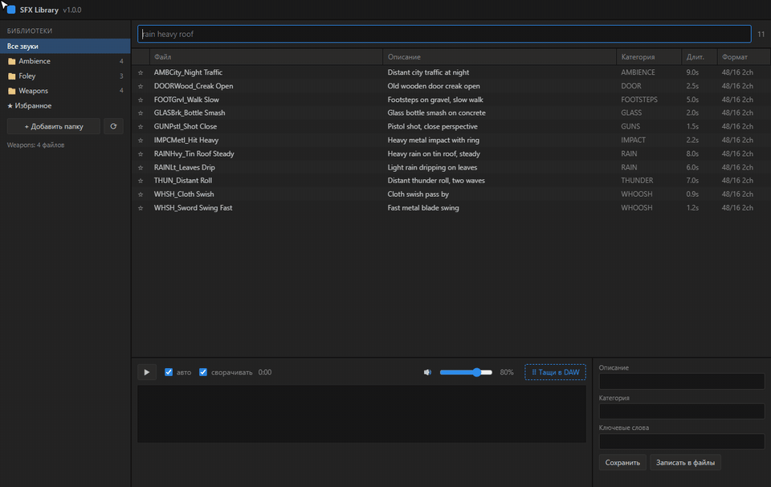

# SFX Library

Менеджер звуковых библиотек для Windows: индексирует твои папки со звуками, ищет по имени и метаданным (BWF/iXML, UCS), показывает вейвформу и перетаскивает звук или выделенный кусок прямо в DAW (Premiere, Reaper, Pro Tools и т. д.).



**Скачать:** [SFXLibrary-Setup.exe](https://github.com/fggtf24-cyber/sfx-library/releases/latest/download/SFXLibrary-Setup.exe). Обновляется само через GitHub Releases.

## Что умеет
- Шрифт и палитра как в Notion, светлая и тёмная тема (или как в системе) — иконка в шапке
- Сортировка «по частоте»: бросок в DAW считается использованием, прослушивание — немного
- Растягиваемые куски в Premiere Pro: кнопка «Premiere» в шапке ставит мост. Брошенный кусок на таймлайне заменяется полным файлом с точками входа и выхода, так что края можно снова растянуть. В других DAW кусок уходит обычным WAV
- Выделение на вейвформе запоминается для каждого звука: вернулся к звуку — можно подправить обрезку и бросить снова
- Повтор (кнопка или L): звук или выделенный кусок играет по кругу
- Поиск в интернете: одна страница в стиле программы, сайт выбирается иконкой — Artlist, Epidemic Sound, Freesound, Pixabay, YouTube. ▶ загружает звук в нижнюю панель (перемотка, выделение, обрезка, перетаскивание в DAW), ↓ скачивает в WAV в выбранную папку и добавляет в библиотеку (название, автор, категория в метаданных). Клик по названию на Artlist открывает альбом
- YouTube: ▶ проигрывает ролик и записывает его звук (реклама пропускается, тишина по краям обрезается, пик −6 dBFS). К запросу сама добавляется фраза «sound effect» — её можно выключить или поменять рядом с поиском
- Аккаунты внизу слева: какие сайты подключены, вход — в отдельном окне
- У сайтов настоящие цветные логотипы, у звуков колонка размера файла
- У сайтов настоящие цветные логотипы, у звуков колонка размера файла
- Обновление ставится тихо: кнопка «Обновить» просто перезапускает программу уже новой версии. При первой установке можно выбрать папку и диск
- Добавить папки → инкрементальный скан (неизменённые файлы не перечитываются)
- Поиск по началу слов в имени, описании, категории, ключевых словах
- Вейвформа: зажал и протянул — выделение; Ctrl+A — выделить весь файл; схватил выделение — тащишь его в DAW (всё выделено — уходит оригинал); клик вне или двойной клик — сброс
- Редактор метаданных, в том числе пачкой; запись в BWF/iXML внутри WAV через временный файл
- Окно прячется, пока тащишь звук, чтобы было видно DAW, и возвращается после броска (галка «прятать»; «не возвращать» — свернуть в панель задач)
- Английский интерфейс: по языку Windows или вручную в шапке
- Избранное, громкость, горячие клавиши (пробел, стрелки, Ctrl+A, Esc)

## Разработка
```
npm install
npm start          # запустить
npm test           # самопроверка wav.js
npm run dist       # собрать dist/SFXLibrary-Setup.exe
```

## Выпуск обновления
1. Поднять `version` в `package.json` и закоммитить.
2. `npm run release` — соберёт установщик, поставит тег `vX.Y.Z` и опубликует релиз через `gh` (нужен `gh auth login`). Установленные копии подхватят его сами и предложат перезапуск.
